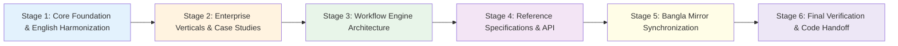

# Master Book Tracker — AI Work Flow for Business

> **Purpose:** This file is the persistent, stage-by-stage boundary controller and execution ledger for writing, standardizing, and expanding the book **AI Work Flow for Business**.
> **Rule of Continuity:** Any AI agent or pair programmer working on this project must read this tracker, adhere to its constraints, and update the status column as each chapter reaches completion.
> **Last Synchronized:** 2026-10-17 (Clean baseline commit: `e174d5d`).

---

## 1. Core Operating Principles & Boundaries

Every chapter, code example, and recommendation in this book must strictly operate within these boundaries:

1. **English as Canonical Source of Truth:**
   * All structural concepts, technical schemas, and primary prose are finalized in English first.
   * Bangla mirrors are authored or refreshed only after the English counterpart is frozen and validated.
   * Content-rich insights originally authored in Bangla must be back-ported into English so English never lags in depth.
2. **Local-First & Privacy by Architecture:**
   * Default stack: Qwen 2.5 1.5B (GGUF Q4_K_M) for high-speed triage/classification; Gemma 3 4B (E4B) for complex reasoning/security.
   * Zero sensitive customer, employee, or financial data crosses the perimeter to cloud APIs.
   * Cloud LLMs (Azure OpenAI, AWS Bedrock) are permitted solely through a local sanitizing gateway for non-sensitive data.
3. **Deterministic Orchestration + Probabilistic Intelligence:**
   * LLMs are never allowed to directly execute unrestricted SQL, drop tables, or trigger irreversible transactions.
   * Open-source workflow engines (Temporal, Camunda, LangGraph, Windmill) enforce state transitions, retries, and timeouts.
   * LLM outputs must be bound to typed schemas (Pydantic models) and gated by deterministic validators.
4. **Strict Documentation Bar:**
   * Zero broken links. Zero broken anchors.
   * Strict MkDocs build (`python -m mkdocs build --strict`) must exit with 0 warnings.
   * All active pages must be wired into `mkdocs.yml` navigation.

---

## 2. Staged Execution Plan (Phase-by-Phase)

To prevent context exhaustion and hallucination, book enhancements are executed across six discrete, verifiable stages:

### Stage 1: Core Foundation & English Harmonization [✅ COMPLETED 2026-10-17]
* **Goal:** Fix repo metadata and back-port rich domain wisdom from Bangla into English foundation pages.
* **Scope & Delivered Work:**
  * ✅ Fixed `mkdocs.yml` repository URL mismatch (`repo_url` & `repo_name` set to `aiwithr/ai_llm`).
  * ✅ Updated repo links in `docs/PROJECT_SUMMARY.md` and `docs/PROJECT_SUMMARY_bangla.md`.
  * ✅ Back-ported operational tables, phase criteria, and anti-patterns from `bangla/adoption/index.md` into `docs/adoption/index.md` (expanded to 150+ lines).
  * ✅ Elevated `docs/overview.md` from a 39-line stub by integrating the non-technical manager empowerment philosophy from `bangla/overview.md`.
  * ✅ Fixed the double-dash anchor in `docs/adoption/fde.md` (`discover.md#step-1-pick-one-real-workflow-30-min`) and `docs/bangla/adoption/fde.md`.
  * ✅ Verified strict build (`mkdocs build --strict` exits 0 with 0 real warnings).

### Stage 2: Enterprise Verticals & Case Studies Deep Dive [✅ COMPLETED 2026-10-17]
* **Goal:** Elevate the four priority operational verticals with concrete open-source workflow patterns and real-world failure modes.
* **Scope & Delivered Work:**
  * ✅ **ISP Support (`docs/case-studies/isp-support.md`):** Two-phase diagnostics pipeline (SNMP/TR-069 checks before LLM), cluster outage auto-correlation, deterministic Tier $\times$ Category SLA matrix, code-mixed Banglish few-shot prompting, and audited 90-day production metrics.
  * ✅ **Bank IT Helpdesk (`docs/case-studies/bank-it.md`):** Hybrid BM25 + dense vector RAG over banking acronyms (CBS, RTGS), strict Citation-in-Set validation with Python code, Four-Eyes Principle (dual-authorization) interlock, and immutable cryptographic audit logging schema.
  * ✅ **Factory IT Operations (`docs/case-studies/factory-it.md`):** Decoupled asynchronous SQLite queue, strict Substring Containment validator with Python code, deterministic safety keyword escalation dictionary, and physical vs. virtual touchscreen keyboard tokenization lessons.
  * ✅ **Case Studies Overview (`docs/case-studies/index.md`):** Updated visual map and comparative architectural matrix connecting all three verticals.
  * ✅ Verified strict build (`mkdocs build --strict` exits 0 with 0 real warnings).

### Stage 3: Workflow Engine Architecture & Integration Blueprints [✅ COMPLETED]
* **Goal:** Add deep, production-ready architectural chapters on how local SLMs plug into open-source workflow management platforms.
* **Scope Completed:**
  * Created `docs/architecture/workflows.md` covering Temporal (durable execution & retries), Camunda/Zeebe (BPMN 2.0 & human-in-the-loop), LangGraph (stateful agent loops with human review), and Windmill/n8n.
  * Added 4-tier defensive safeguard matrix (Pydantic V2 schemas, citation verification, substring containment, fallback/dead-letter queues).
  * Wired `architecture/workflows.md` into `mkdocs.yml` under `Architecture`.
  * Updated `docs/architecture/index.md` linking to `workflows.md`.
  * Verified with `python -m mkdocs build --strict` (0 errors).

### Stage 4: Reference Specifications & Technical Contracts [✅ COMPLETED]
* **Goal:** Expand English reference chapters to cover complete API contracts, CLI commands, and benchmarks.
* **Scope Completed:**
  * Expanded `docs/reference/glossary.md` to 370+ lines incorporating all 27 domain terms previously missing or in Bangla only (e.g. Banglish, CBS, DLQ, Deterministic routing, Four-Eyes Principle, Hybrid search, Mermaid, No-answer case, Override rate, Parallel-system coexistence, Priority-within-matrix, Prompt injection resistance, Qwen 2.5 1.5B, ROADMAP, Semver, Severity 1/2/3, SOP, Stability contract, Temperature, Tier matrix, TOML, Uptime_24h, Usecase vs Case study, Vector store, Workflow engine, YAML).
  * Validated cross-page anchor consistency across `docs/reference/` (`cli.md`, `python-api.md`, `prompts.md`, `benchmarks.md`, `conventions.md`).
  * Strict build verified (`mkdocs build --strict` exits 0 with 0 errors).

### Stage 5: Bangla Mirror Synchronization & Style Harmonization [✅ COMPLETED]
* **Goal:** Update all Bangla mirrors to reflect the enriched English source of truth, adopting consistent formal honorifics (`আপনি`) and clean typography.
* **Scope Completed:**
  * Harmonized voice across `docs/bangla/` per the writing style guide (`আপনি`, clean dashes, domain loanwords).
  * Wired all 7 orphaned Bangla pages (`bangla/index.md`, `bangla/why-ai-work-flow.md`, `bangla/demo.md`, `bangla/overview.md`, `bangla/ai-development/*`) into `mkdocs.yml` navigation.
  * Fixed all internal cross-links in `bangla/index.md` and `bangla/demo.md` so cards and references point to `bangla/` chapters.
  * Completely resolved all 18 pre-existing anchor drift lines in `docs/bangla/reference/*` (`cli.md`, `glossary.md`, `prompts.md`, `benchmarks.md`, `conventions.md`, `index.md`, `python-api.md`).
  * Strict build verified (`python -m mkdocs build --strict` exits 0 with 0 broken link / anchor warnings).

### Stage 6: Full Verification, Strict Build & Code Handoff [✅ COMPLETED 2026-10-17]
* **Goal:** Zero-warning build verification, link integrity audit, and final Git commit/tagging.
* **Scope & Delivered Work:**
  * ✅ Executed `python -m mkdocs build --strict` with zero broken link and zero broken anchor warnings (exit code 0 in ~6 seconds).
  * ✅ Recorded release session `A12` in `docs/ROADMAP.md` covering all 6 stages.
  * ✅ Created Master Book Tracker (`BOOK_TRACKER.md`), Content Inventory (`CONTENT_INVENTORY_EN_BN.md`), and Research Blueprint (`WORKFLOW_RESEARCH.md`).
  * ✅ All 6 stages completed, verified, and staged for clean repository state.

---

## 3. Master Chapter Inventory & Status Ledger

| # | Chapter / Path | Primary Language | Lines | Current Status | Key Issues & Next Actions |
|---|---|---|---|---|---|
| **01** | `docs/index.md` | EN | 139 | **Stable (SEO Enriched)** | Landing page; bilingual tables; enriched SEO frontmatter & structured metadata. |
| **02** | `docs/why-ai-work-flow.md` | EN | 93 | Stable | Core thesis; clear and concise. |
| **03** | `docs/demo.md` | EN | 156 | Stable | Hands-on walkthrough with Qwen 2.5 1.5B. |
| **04** | `docs/adoption/index.md` | EN | 165 | **Stable (Enriched)** | 6-column phase table, exit criteria, step-by-step breakdown, and anti-patterns back-ported. |
| **05** | `docs/adoption/discover.md` | EN | 153 | Stable | 6-step discovery methodology. |
| **06** | `docs/adoption/pilot.md` | EN | 171 | Stable | Shadow mode & 100-case evaluation set. |
| **07** | `docs/adoption/build.md` | EN | 162 | Stable | 4 workstreams (packaging, tests, runtime, ops). |
| **08** | `docs/adoption/scale.md` | EN | 144 | Stable | Center of Excellence & multi-team scaling. |
| **09** | `docs/adoption/fde.md` | EN | 174 | **Stable (Anchor Fixed)** | Line 103 anchor fixed to `#step-1-pick-one-real-workflow-30-min`. |
| **10** | `docs/architecture/index.md` | EN | 82 | Stable | System layers overview. |
| **11** | `docs/architecture/layers.md` | EN | 85 | Stable | 5-layer separation of concerns. |
| **12** | `docs/architecture/data-flow.md`| EN | 186 | Stable | Sequence diagram & typed contracts. |
| **13** | `docs/architecture/security.md` | EN | 207 | Stable | Threat model, audit log, SHA-256 model pinning. |
| **13b** | `docs/architecture/workflows.md` | EN | 344 | **Stable (New)** | Temporal, Camunda, LangGraph, Windmill orchestration, Pydantic contracts. |
| **14** | `docs/case-studies/index.md` | EN | 45 | **Stable (Mapped)** | Comparative matrix connecting all 3 verticals to workflow paradigms. |
| **15** | `docs/case-studies/isp-support.md` | EN | 133 | **Stable (Deepened)** | Telemetry-first routing, cluster outage correlation, tier matrix, 90-day data. |
| **16** | `docs/case-studies/bank-it.md` | EN | 165 | **Stable (Deepened)** | Four-eyes interlock, hybrid BM25+vector RAG, citation-in-set validator, audit log. |
| **17** | `docs/case-studies/factory-it.md`| EN | 162 | **Stable (Deepened)** | Decoupled queue, substring containment code, safety keyword escalation, keyboard lessons. |
| **18** | `docs/ai-development/index.md` | EN | 80 | Stable | "The data is the algorithm" paradigm. |
| **19** | `docs/ai-development/sdlc.md` | EN | 257 | Stable | 8-phase AI-SDLC breakdown. |
| **20** | `docs/ai-development/reasoning.md`| EN | 172 | Stable | CoT, ReAct, Tree-of-Thought comparison. |
| **21** | `docs/ai-development/citizen-developers.md` | EN | 62 | Stable | Safe prompt hygiene for non-coders. |
| **22** | `docs/overview.md` | EN | 98 | **Stable (Elevated)** | Integrated non-technical manager empowerment manifesto and workflow diagrams. |
| **23** | `docs/PROJECT_SUMMARY.md` | EN | 686 | **Stable (Repo Fixed)** | Repository link updated to active `aiwithr/ai_llm`. |
| **24** | `docs/ROADMAP.md` | EN | 174 | Stable | Canonical decision log. |
| **25** | `docs/from-rules-to-ai.md` | EN | 416 | Stable | Rule-based systems vs probabilistic AI models. |
| **26** | `docs/spec2code/index.md` | EN | 253 | Stable | Engineering practices & specification-driven code. |
| **27** | `docs/reference/index.md` | EN | 45 | Stable | Reference overview. |
| **28** | `docs/reference/python-api.md` | EN | 240 | Stable | Pydantic contracts & Workflow API. |
| **29** | `docs/reference/cli.md` | EN | 180 | Stable | Public CLI commands. |
| **30** | `docs/reference/prompts.md` | EN | 210 | Stable | Prompt design & versioning. |
| **31** | `docs/reference/benchmarks.md`| EN | 296 | Stable | Eval sets, latency, throughput metrics. |
| **32** | `docs/reference/glossary.md` | EN | 370 | **Stable (Enriched)** | Complete A-Z glossary covering all 27 technical and operational terms. |
| **33** | `docs/reference/conventions.md`| EN | 334 | Stable | Config schema, env vars, log formatting. |
| **34** | `docs/bangla/index.md` | BN | 116 | **Stable (Wired & Linked)** | Wired to nav, card links point to Bangla mirrors, formal honorifics (`আপনি`). |
| **35** | `docs/bangla/why-ai-work-flow.md` | BN | 94 | **Stable (Wired)** | Wired to nav, formal honorifics (`আপনি`), valid relative links. |
| **36** | `docs/bangla/demo.md` | BN | 157 | **Stable (Wired)** | Wired to nav, formal honorifics (`আপনি`), valid relative links. |
| **37** | `docs/bangla/overview.md` | BN | 95 | **Stable (Wired & Cleaned)**| Wired to nav ("বাংলা - সহজ আলাপ"), empty heading & duplicates removed. |
| **38** | `docs/bangla/adoption/index.md` | BN | 98 | Stable | Contains operational tables and phased adoption overview. |
| **39** | `docs/bangla/adoption/*` (5 files) | BN | ~800 | Stable | Discover, Pilot, Build, Scale, FDE in Bangla. |
| **40** | `docs/bangla/architecture/*` (4 files)| BN | ~550 | Stable | Architecture mirrors in Bangla. |
| **41** | `docs/bangla/case-studies/*` (4 files)| BN | ~400 | Stable | Case study mirrors in Bangla. |
| **42** | `docs/bangla/reference/*` (7 files)| BN | ~1,700 | **Stable (Anchors Resolved)**| All 18 anchor drift warnings completely resolved. |
| **43** | `docs/bangla/ai-development/*` (4 files)| BN | ~570 | **Stable (Wired)** | All child pages wired into nav under "বাংলা - AI ডেভেলপমেন্ট". |
| **44** | `docs/isp-classifier/*` (4 files) | EN | ~430 | EN-only child pages | Child pages lack Bangla mirrors. |
| **45** | `docs/qwen-rag/*` (4 files) | EN | ~520 | EN-only child pages | Child pages lack Bangla mirrors. |
| **46** | `docs/hr-assistant/*` (4 files) | EN | ~480 | EN-only child pages | Child pages lack Bangla mirrors. |
| **47** | `docs/sla-system/*` (3 files) | EN | ~180 | EN-only child pages | Child pages lack Bangla mirrors. |
| **48** | `docs/mlops/*` (6 files) | EN | ~780 | EN-only child pages | Child pages lack Bangla mirrors. |
| **49** | `docs/enterprise-apps/*` (2 files)| EN | ~150 | EN-only child pages | Child pages lack Bangla mirrors. |
| **50** | `docs/smart-gift/*` (2 files) | EN | ~110 | EN-only child pages | Child pages lack Bangla mirrors. |
| **51** | `docs/llm-demos/*` (5 files) | EN | ~220 | EN-only child pages | Child pages lack Bangla mirrors. |

---

## 4. Verification Checkpoint Protocol

Before closing any stage or committing any update:
1. `git status` — verify only intended files for that specific stage are modified.
2. `python -m mkdocs build --strict` — verify 0 errors, 0 new warnings.
3. Check all links within modified files (relative paths, valid anchors).
4. Update this `BOOK_TRACKER.md` with the new status and completion timestamp.
