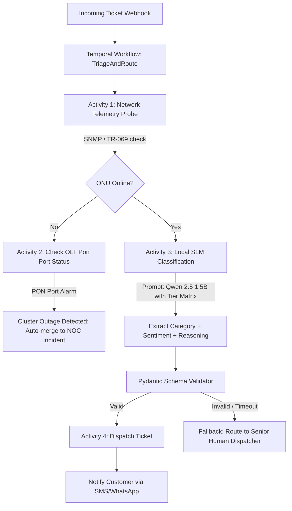
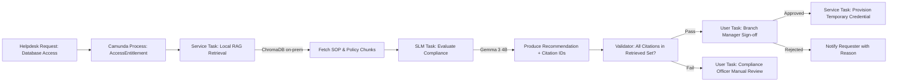
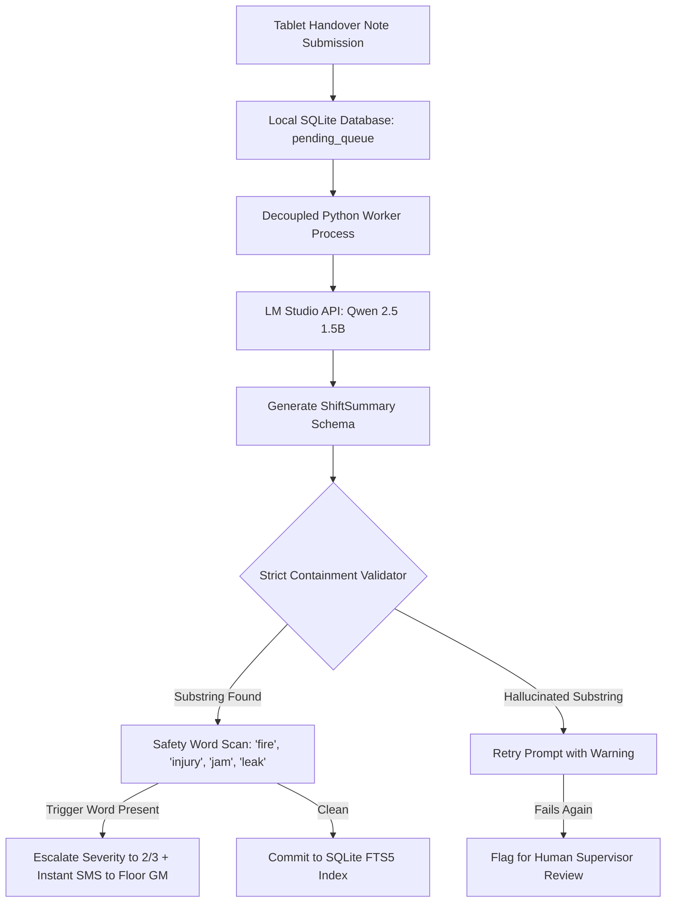
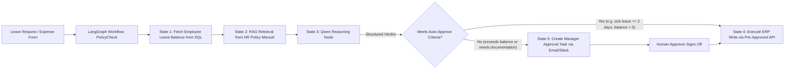

# Open-Source Workflow Management Research & Architectural Blueprint

> **Purpose:** Comprehensive research on open-source workflow management engines and their architectural integration with local Small Language Models (SLMs: Qwen 2.5 1.5B, Gemma 3 4B) across four key business segments: **ISP / Telecom**, **Banking / Financial IT**, **Manufacturing / Factory Floor**, and **Cross-Cutting Enterprises**.
> **Core Architectural Premise:** Deterministic workflow engines must own state, retries, transactions, human-in-the-loop gates, and audit trails. Local language models operate strictly as specialized, typed evaluation nodes within those workflows.

---

## 1. The Landscape of Open-Source Workflow Engines

Modern workflow management platforms fall into four distinct categories. Selecting the right engine depends on the operational requirement:

| Engine | Primary Paradigm | Best Fit For | Local SLM Integration Pattern | Licensing / Hosting |
|---|---|---|---|---|
| **Temporal.io** | Code-as-Workflow (Durable Execution) | Mission-critical, distributed, long-running processes (ISP NOC, Bank IT) | SLM calls executed inside Activity Workers with automated exponential backoff and timeouts. | MIT / Apache 2.0; Self-hosted Docker/K8s |
| **Camunda 8 (Zeebe)** / **Flowable** | BPMN 2.0 & DMN (Visual & Decision Tables) | Regulated compliance, formal audit trails, four-eyes human approvals | SLM deployed as an external Job Worker; DMN table handles business rule escalation. | Zeebe (Self-Managed available); Flowable (Apache 2.0) |
| **LangGraph** | Stateful Graph / Multi-Agent State Machine | Complex reasoning loops, dynamic tool calling, branch exploration | Direct Python native graph; checkpoints persisted to PostgreSQL/SQLite; built-in human interrupt. | MIT; Native Python library |
| **Windmill** | Developer-First Script Orchestration | Fast internal tools, cron automations, multi-step data pipelines | Python script steps calling local FastAPI/LM Studio endpoint with auto-generated UI. | AGPLv3 / Enterprise; Self-hosted Docker |
| **n8n** | Node-Based Low-Code Workflow | Rapid API integrations, webhook handling, alert dispatching | HTTP Request / AI Agent nodes calling local OpenAI-compatible endpoint (`http://localhost:1234/v1`). | Fair-code (Sustainable Use); Self-hosted Docker |
| **Apache Airflow** | Scheduled Batch DAGs | MLOps pipelines, nightly batch evaluations, model retraining triggers | Batch inference tasks over historical ticket databases. | Apache 2.0; Self-hosted |

---

## 2. Segment-by-Segment Workflow Architectures

### Segment 1: ISP / Telecom Operations (NOC, Field Ops, Support)

#### Operational Realities
* **High Volume & Velocity:** Thousands of complaints daily across broadband, fiber, and IPTV.
* **Mixed Language Input:** Tickets written in English, Bengali, or phonetic "Banglish" (e.g., *"net connection pawa jacche na, router LOS red blink kortese"*).
* **High Penalty for Misclassification:** P1 fiber outages or VIP corporate lease-line drops misrouted as routine residential billing issues cause severe SLA breach penalties.

#### Production Workflow Blueprint: Temporal + Local Qwen 2.5 1.5B


#### Key Technical Rules for ISP Workflows
1. **Never Call SLM Before Deterministic Telemetry:** If the OLT reports optical loss of signal across 50 users on the same PON card, an outage is already mathematically proven. Do not waste GPU cycles asking the SLM; trigger the NOC incident directly.
2. **Deterministic Tier Matrix:** Priority is determined by a hard lookup matrix:
   $$\text{Priority} = \text{Lookup}(\text{CustomerTier}, \text{PredictedCategory})$$
   A Platinum corporate customer with a latency issue is automatically P1; a Silver customer with a billing question is P3. The model predicts the *category*; code dictates the *priority*.
3. **Fail-Safe Routing:** If LM Studio fails or response exceeds 800 ms, the Temporal activity retries once, then diverts the ticket to a human queue tagged `AI_TIMEOUT`. Operations never stall.

---

### Segment 2: Banking & Financial IT Operations

#### Operational Realities
* **Strict Regulatory Compliance:** Zero telemetry or customer/financial data may leave the on-prem perimeter (strict Bangladesh Bank ICT Guidelines, GDPR, SOC2).
* **Auditability & Traceability:** Every automated decision or recommendation must preserve an immutable audit trail showing the model version, temperature, prompt template, retrieval citations, and approval signatures.
* **Dual-Control (Four-Eyes Principle):** AI never approves access or transactions autonomously; it acts as an analyst presenting structured evidence to a human officer.

#### Production Workflow Blueprint: Camunda 8 (BPMN) + Qwen RAG


#### Key Technical Rules for Bank Workflows
1. **Citation-in-Set Enforcement:** The RAG retrieval engine stores chunk IDs (`chunk_id_1042`). If the SLM's output cites a policy clause whose `chunk_id` was not in the prompt's retrieved context, the response is instantly rejected as a hallucination.
2. **Immutable Audit Ledger:** Every workflow writes a structured audit record:
   ```json
   {
     "workflow_id": "wf-bank-9941",
     "timestamp": "2026-10-17T14:30:00Z",
     "actor_id": "EMP-4019",
     "model_id": "gemma-3-4b-e4b-gguf",
     "model_sha256": "8a3f91...e41b",
     "prompt_version": "v2.1",
     "temperature": 0.0,
     "retrieval_chunks": ["sop_core_db_v4#sec3"],
     "recommendation": "DENY",
     "justification": "Branch teller roles cannot hold direct production write privileges per Section 3.2.",
     "human_approver": null
   }
   ```
3. **Deterministic Human Interlock:** The automated workflow stops at a `UserTask`. The manager must explicitly click "Approve" or "Reject". The SLM does the homework; the human takes legal responsibility.

---

### Segment 3: Manufacturing & Factory Floor Operations

#### Operational Realities
* **24/7 Multi-Shift Cadence:** Shift handovers occur every 8 hours without interruption. Handover notes written by line leaders must be processed within minutes.
* **Challenging Input Modality:** Line leaders write on ruggedized tablets, frequently using colloquial, truncated, or mixed-language phrases.
* **Zero-Hallucination Bar:** Safety incidents (e.g., machine belt snap, chemical leak, guardrail displacement) must never be missed or hallucinated away.

#### Production Workflow Blueprint: SQLite Queue + Containment Validator Worker


#### Key Technical Rules for Factory Workflows
1. **Strict Substring Containment:** For every machine issue or defect string in the model's JSON output, the validator executes a literal string containment check against the input text. If the model generates a defect not found in the original line leader's note, the summary is rejected.
2. **Decoupled Asynchronous Queue:** The worker typing the note on the tablet receives an immediate HTTP 200 acknowledgment. The LLM processing runs in the background. If the local LLM host reboots or runs slow, notes accumulate safely in SQLite and drain automatically upon model recovery.
3. **Safety Keyword Override:** A deterministic Python dictionary of critical words (`"smoke"`, `"spark"`, `"belt"`, `"jam"`, `"cut"`) forces severity to Maximum ($3$) regardless of what confidence score the LLM produced.

---

### Segment 4: Cross-Cutting Enterprise Operations (HR, ERP, Admin)

#### Operational Realities
* **Repetitive Administrative Overhead:** HR policy questions, leave balance reconciliation, expense claim triage, procurement invoice matching.
* **Siloed Backends:** Data trapped across legacy ERPs, relational databases, LDAP/Active Directory, and spreadsheets.
* **Empowering Non-Programmers:** Citizen developers in HR or Finance need to build automations safely without writing raw code or accessing production DB credentials.

#### Production Workflow Blueprint: Windmill / LangGraph + Typed Action Contracts


#### Key Technical Rules for Enterprise Workflows
1. **The Typed-Action Contract:** Citizen developers never write SQL or direct database queries. Instead, the workflow exposes strictly typed action blocks:
   ```python
   class ApproveLeaveAction(BaseModel):
       employee_id: str
       leave_type: Literal["casual", "sick", "annual"]
       start_date: date
       end_date: date
       manager_signoff_hash: str
   ```
2. **Privacy Sandboxing:** Employee health records, salary details, or disciplinary files are processed exclusively by on-prem models with zero logging of raw personal text to disk.
3. **Self-Service Approval UI:** Platforms like Windmill or n8n provide instant web-based approval modals for department heads, avoiding email clutter and ensuring timestamps are logged.

---

## 3. Recommended Architectural Stack for This Book

To keep the book practical, cohesive, and grounded, we standardize on the following open-source toolchain:

| Capability | Recommended Open-Source Tool | Why Selected |
|---|---|---|
| **Local LLM Engine** | **LM Studio** / **Ollama** / **vLLM** | Zero-cloud footprint, GGUF/AWQ quantized inference, OpenAI-compatible API on `localhost:1234`. |
| **Durable Orchestration** | **Temporal.io** (Production) / **Python LangGraph** (Lightweight) | Temporal provides enterprise resilience; LangGraph provides native Python stateful agent loops. |
| **BPMN & Human Tasks** | **Camunda 8 (Self-Managed)** / **Flowable** | Standard visual workflow definitions for banks and enterprises requiring formal audit compliance. |
| **Internal UI & Workflows**| **Windmill** / **Streamlit** | Fast, self-hosted UI creation for operators and floor managers without building custom web apps. |
| **Vector Database** | **ChromaDB** | Self-contained, file-backed or client-server, 100% on-premise, zero external infrastructure required. |
| **Validation Framework** | **Pydantic V2** | Enforces typed schemas, JSON serialization, and deterministic input/output validation contracts. |
