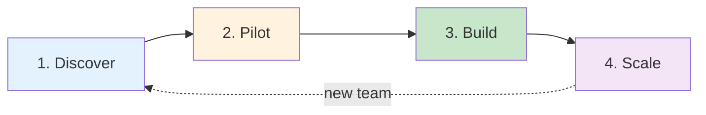
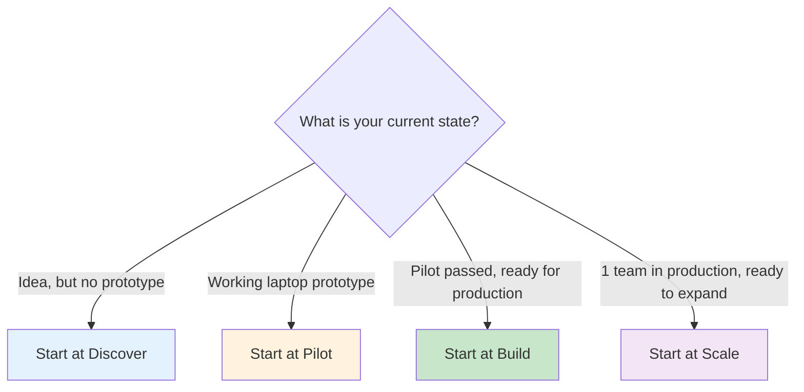

# Adoption journey

Bringing a local LLM workflow into production is not a single decision. It is a four-phase journey. Each phase has a clear entry criterion, a clear exit criterion, a strict time-box, and a deliverable that serves as the foundation for the next phase. Skipping a phase does not save time — it multiplies technical debt when earlier omissions resurface under production load.

---

## The four phases at a glance

| Phase | Core Question | What you do in this phase | Time-Box | Team Allocation | Exit Criteria / Deliverable |
|---|---|---|---|---|---|
| [**1. Discover**](discover.md) | *"Is local LLM worth considering for my team?"* | Screen 2–3 candidate workflows, sanity-check hardware fit, calculate business value. | 1 day | 1 engineer + sponsor | One-page decision memo: **Yes** / **No** / **Yes-with-conditions** |
| [**2. Pilot**](pilot.md) | *"Can we ship one workflow in 2 weeks?"* | Build workstation prototype, curate 100-case real ticket test set, run 1-week shadow mode. | 2–4 weeks | 1–2 engineers | Shadow-mode run meeting the precision/recall bar on real data |
| [**3. Build**](build.md) | *"How do we put it in production?"* | Containerize service, enforce prompt versioning, set up telemetry, author ops runbook. | 4–8 weeks | 2–3 engineers + Ops | Production service deployed, health alerts active, rollback tested |
| [**4. Scale**](scale.md) | *"How do we roll out to 5+ teams?"* | Stand up shared multi-tenant platform, launch Center of Excellence (CoE), build onboarding kit. | 3–6 months | Small platform team | 5+ independent teams shipping workflows over a shared platform |
| [**5. FDE**](fde.md) | *"What is the role that runs all four phases?"* | Audit $\rightarrow$ Evals $\rightarrow$ Deployment: the Forward Deployed Engineer operational methodology. | 12 weeks | 1–3 engineers | Customer engineers own the system; handoff memo signed |

---

## The FDE lens — the role that runs the phases

The four phases form an operational playbook. The role that executes them end-to-end is the **Forward Deployed Engineer (FDE)** — a senior technical engineer embedded within the customer's operations who ships the first working system on the customer's own hardware and hands it over before departing.

FDE is the standard industry role across applied-AI organizations (Palantir, OpenAI, Anthropic), and it is a role an on-premise local-LLM programme *cannot do without*: the data-residency constraint forces engineering on-site, and "on-site engineering" is precisely the FDE discipline.

[FDE chapter (5)](fde.md) ties the four phases to the broader industry landscape:
* **Audit $\rightarrow$ Discover:** Rapid on-floor pre-mortem, workflow screening, bottleneck mapping.
* **Evals $\rightarrow$ Pilot:** Shadow-mode validation, evaluation set curation, accuracy bars.
* **Deployment $\rightarrow$ Build + Scale:** Hardening on customer hardware, telemetry, ops handover.

Every phase is **time-boxed**, not feature-boxed. If a 4-week pilot fails to meet its accuracy bar, the root problem is the workflow candidate or data readiness, not the development timeline. Do not extend the pilot indefinitely — kill the candidate, select another workflow, and re-enter Discover.

---

## What actually happens in each phase

### 1. Discover — "Is this our job?"

In Discover, you do not train models, build APIs, or purchase server clusters. You answer a single operational question: **Is this specific workflow viable and worth automating with a small, local LLM?**

A single engineer works alongside the operational sponsor for one day to answer three screening questions:
1. **Estimated Business Value:** What is the tangible impact? (e.g., saving 15 engineering minutes per ticket across 2,000 monthly tickets, or cutting misrouted escalations by 40%).
2. **Hardware & Topology Fit:** Can the target model fit on available hardware? For Qwen 2.5 1.5B (GGUF Q4_K_M), a single workstation GPU or modern laptop with 8–16 GB RAM suffices. For Gemma 3 4B (E4B), verify 24–48 GB VRAM.
3. **One-Line Executive Verdict:** Produce a one-page memo signed by the customer's operational sponsor with a clear verdict: **Yes**, **No**, or **Yes-with-conditions** (e.g., "Yes, provided customer PII is scrubbed before indexing").

### 2. Pilot — "Does this actually work?"

With a positive Discover verdict, enter Pilot. The objective is to **prove feasibility on real customer data** using a local prototype:
* Build a local prototype using LM Studio or a lightweight Python script.
* Curate a benchmark test set of **100+ real operational cases** (actual support complaints, shift notes, or SOP queries — never purely synthetic data).
* Run the prototype in **shadow mode** for at least one full week: human operators continue making decisions, while the model generates recommendations in parallel.
* Evaluate output against pre-agreed precision and recall thresholds.

**Pilot rule:** Hard cap of 4 weeks. If the prototype does not satisfy the bar within 4 weeks, the workflow is not a suitable automation candidate.

### 3. Build — "How do we run this in production?"

When the Pilot proves the accuracy bar, transition into Build. Here, the prototype is engineered into a **hardened production service**:
* Wrap inference in a robust API (FastAPI) with health checks, connection pooling, and retry logic.
* Implement prompt version control (`prompts/triage.v2.txt`) and schema validation (Pydantic V2).
* Author comprehensive operational runbooks: deployment steps, telemetry dashboards, log retention rules, and tested rollback procedures.
* Ensure the service adheres to the standard ops stack: if the model crashes or host reboots, queues buffer incoming requests without data loss.

**Build rule:** Time-box to 4–8 weeks. Deliverable is a running production service owned jointly with the Operations team.

### 4. Scale — "How do 5+ teams adopt this?"

Once one workflow is running reliably in production, enter Scale. The focus shifts from a single module to an **enterprise adoption platform**:
* Stand up a shared, multi-tenant local gateway (LM Studio / vLLM cluster) serving multiple business units.
* Create a self-service onboarding kit with standardized prompt templates and typed schema blueprints.
* Establish a small **Center of Excellence (CoE)** responsible for platform stability, model updates, and eval harness tooling.

**Scale rule:** The milestone is reached when **at least 5 independent operational teams** ship and manage their own local workflows autonomously over the shared platform.

---

## How to move from phase to phase

A phase transition requires two structural checkpoints:
1. **The Tangible Deliverable:** A formal document, code package, or deployment artifact that the subsequent team can immediately execute.
2. **Exit Criteria Verification:** Explicit numerical validation (target accuracy, uptime, response latency) verified against baseline bars.

Hold a strict **30-minute retrospective** at each boundary to document lessons learned, followed by a formal handoff meeting with the next phase's team. Clear handoffs prevent backward rework — the single largest source of enterprise project failure.

---

## Where should you start?

---

## Common mistakes and why they fail

| Anti-Pattern | Root Cause of Failure | Remediation |
|---|---|---|
| **Skipping Discover $\rightarrow$ Pilot** | Committing engineering cycles to workflows that have hardware incompatibilities or unmeasurable ROI. | Enforce the 1-day Discover pre-mortem and executive sponsor sign-off. |
| **Skipping Pilot $\rightarrow$ Build** | Discovering 3 months into service development that the SLM cannot meet the precision bar on edge cases. | Mandate a 100-case shadow-mode run before authoring production service code. |
| **Scaling without a Shared Platform** | Every team rewrites their own LM Studio client, custom telemetry, and isolated runbooks. | Establish a CoE and standard gateway before onboarding team #2. |
| **Platform before Workflows** | Designing an abstract "Enterprise AI Platform" before proving a single live workflow in production. | Always build ground-up: one working workflow first, platform second. |

---

## Next step

* Finished Discover? [Read the Case Studies](../case-studies/index.md) to examine measured production results across ISP, Bank, and Factory operations.
* Ready to evaluate a workflow? Jump directly to [Discover](discover.md).
