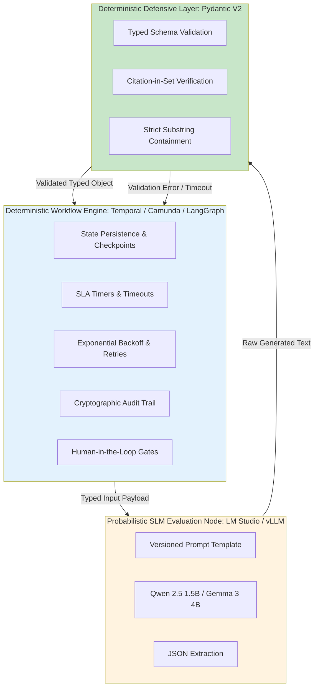
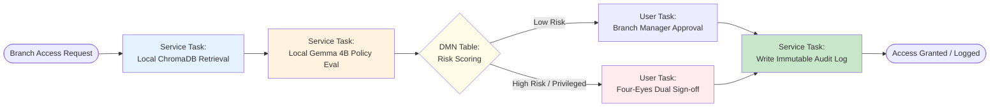
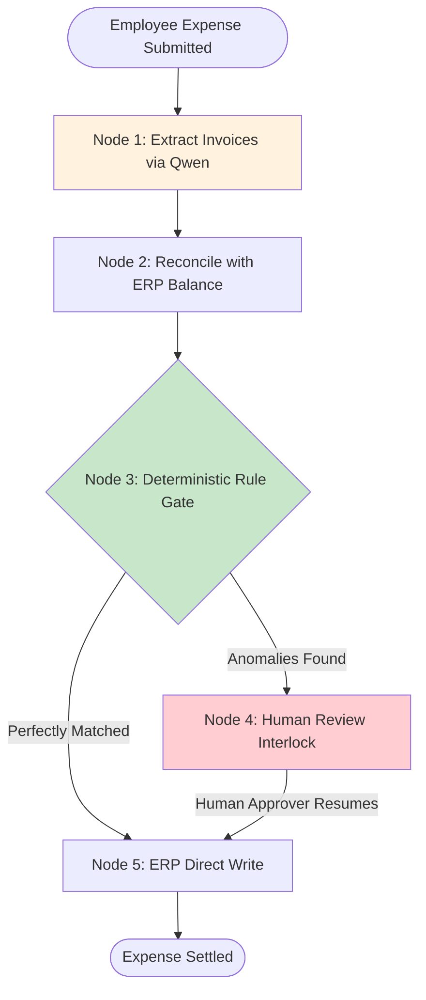
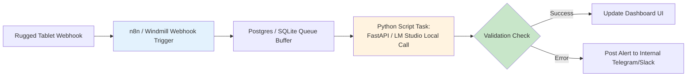

# Workflow Orchestration & Engine Integration

> **Core Architectural Doctrine:** Workflow engines must own state, retries, transactions, human-in-the-loop gates, and audit trails. Local Small Language Models (SLMs: Qwen 2.5 1.5B, Gemma 3 4B) operate strictly as specialized, typed evaluation nodes within those deterministic workflows.

---

## The separation of concerns: state vs. intelligence

A critical vulnerability in early enterprise AI deployments is treating an LLM as an autonomous agent with open-ended execution authority. Giving a probabilistic language model direct, unconstrained access to write to production databases, issue network reconfiguration commands, or execute financial transactions inevitably produces catastrophic edge-case failures.

AI Work Flow for Business enforces a strict **separation of concerns**:



1. **The Workflow Engine is Deterministic:** It guarantees that steps execute in exact sequence, persists workflow state across server reboots, tracks SLA countdown timers, manages retry budgets, and halts execution for human sign-offs.
2. **The Local SLM is a Pure Function:** It takes a strictly formatted input text, evaluates the semantic nuance using frozen weights running on local hardware, and returns structured data. It has no side effects and cannot make network calls independently.
3. **The Defensive Layer is a Hard Barrier:** Between the SLM and the engine sits a deterministic validation layer. If the model output fails schema parsing, hallucinates an unmentioned entity, or invents a non-existent citation, the response is rejected before the workflow engine updates state.

---

## 1. Temporal.io Blueprint: Durable Distributed Execution

**Best fit for:** ISP Network Operations Centers (NOC), high-volume ticket routing, distributed microservices, and workflows requiring guaranteed execution over days or weeks.

In Temporal, **Workflows** are deterministic code that orchestrates tasks, while **Activities** perform external calls (such as invoking local SLMs or querying network hardware). If the server running LM Studio crashes or reboots during inference, Temporal automatically retries the Activity with exponential backoff without losing ticket state.

### Implementation: Temporal Activity for Local SLM Inference

```python
# activities.py
import requests
from pydantic import BaseModel, Field
from temporalio import activity
from typing import Literal

class TriageResult(BaseModel):
    category: Literal["billing", "noc_routing", "latency", "dns", "hardware"]
    confidence: float = Field(ge=0.0, le=1.0)
    entities: list[str]

@activity.defn
async def classify_ticket_activity(ticket_text: str) -> TriageResult:
    """Invokes local Qwen 2.5 1.5B on LM Studio with timeout and schema validation."""
    payload = {
        "model": "qwen2.5-1.5b-instruct",
        "messages": [
            {
                "role": "system", 
                "content": "You are an ISP triage classifier. Output JSON matching the TriageResult schema."
            },
            {"role": "user", "content": ticket_text}
        ],
        "temperature": 0.0,
        "max_tokens": 150
    }
    
    # 2.5-second timeout for local inference activity
    response = requests.post(
        "http://localhost:1234/v1/chat/completions", 
        json=payload, 
        timeout=2.5
    )
    response.raise_for_status()
    raw_content = response.json()["choices"][0]["message"]["content"]
    
    # Deterministic Pydantic validation: raises ValidationError if schema fails
    return TriageResult.model_validate_json(raw_content)
```

### Implementation: Temporal Workflow with Deterministic Fallbacks

```python
# workflows.py
from datetime import timedelta
from temporalio import workflow
from temporalio.common import RetryPolicy

with workflow.unsafe.imports_passed_through():
    from activities import classify_ticket_activity, TriageResult, check_snmp_optical_power

@workflow.defn
class TicketTriageWorkflow:
    @workflow.run
    async def run(self, ticket_id: str, customer_tier: str, text: str) -> dict:
        # Step 1: Telemetry check FIRST (SNMP probe before LLM)
        telemetry = await workflow.execute_activity(
            check_snmp_optical_power,
            ticket_id,
            start_to_close_timeout=timedelta(seconds=2)
        )
        
        if telemetry["optical_loss_of_signal"]:
            return {
                "ticket_id": ticket_id,
                "category": "noc_routing",
                "priority": "P1",
                "reason": "Automated physical fiber LOS alarm"
            }
        
        # Step 2: Probabilistic SLM Activity with automated retry policy
        try:
            triage: TriageResult = await workflow.execute_activity(
                classify_ticket_activity,
                text,
                start_to_close_timeout=timedelta(seconds=4),
                retry_policy=RetryPolicy(
                    initial_interval=timedelta(seconds=1),
                    maximum_interval=timedelta(seconds=3),
                    maximum_attempts=2
                )
            )
            category = triage.category
        except Exception:
            # Step 3: Dead-letter fallback if SLM host fails or times out
            category = "manual_triage_queue"

        # Step 4: Deterministic Tier Matrix lookup in code
        priority = "P1" if (customer_tier == "platinum" and category == "noc_routing") else "P3"

        return {
            "ticket_id": ticket_id,
            "category": category,
            "priority": priority,
            "sla_hours": 1 if priority == "P1" else 8
        }
```

---

## 2. Camunda 8 / Flowable Blueprint: BPMN 2.0 & Formal Compliance

**Best fit for:** Commercial banks, financial services, healthcare, and enterprise audit departments requiring visual process modeling, ISO/central bank compliance, and four-eyes dual authorization.



### Key Architectural Components in Camunda:
1. **External Job Workers (Service Tasks):** Camunda's Zeebe broker publishes task events to a local topic (`evaluate-sop`). A Python worker daemon queries on-premise ChromaDB for relevant SOP chunks, passes context to **Gemma 3 4B**, and completes the job with structured variables.
2. **DMN Decision Tables:** Business rules (e.g., *"If requested role is Core Banking Database Admin, risk level is automatically CRITICAL"*) reside inside versioned DMN XML tables, completely independent of the LLM prompt.
3. **Four-Eyes User Tasks:** The process model explicitly includes a `UserTask` assigned to a human officer. Camunda's native engine prevents process continuation until the manager and security officer independently submit cryptographic approvals.

---

## 3. LangGraph Blueprint: Stateful Multi-Step Agent Graphs

**Best fit for:** Complex operational investigations, multi-step document verification, and iterative triage requiring stateful memory and human interrupt gates.

Unlike unconstrained agent loops, **LangGraph** models the process as a bounded, directed acyclic graph (DAG) where state is persisted to a local SQLite or PostgreSQL checkpoint database.



### Implementation: LangGraph with Human-in-the-Loop Interrupt

```python
from typing import TypedDict, Literal
from langgraph.graph import StateGraph, END
from langgraph.checkpoint.sqlite import SqliteSaver

class ExpenseState(TypedDict):
    claim_id: str
    amount_bdt: float
    receipt_text: str
    extracted_vendor: str
    policy_compliant: bool
    requires_human_signoff: bool
    manager_decision: Literal["PENDING", "APPROVED", "REJECTED"]

def slm_extraction_node(state: ExpenseState) -> dict:
    """Uses local SLM to extract vendor and match against claim amount."""
    # (Extracts vendor and items using Qwen 2.5 1.5B)
    return {"extracted_vendor": "Beximco Office Supplies"}

def policy_gate_node(state: ExpenseState) -> dict:
    """Deterministic policy rules: claims over 25,000 BDT require human approval."""
    needs_review = state["amount_bdt"] > 25000.0 or not state["policy_compliant"]
    return {"requires_human_signoff": needs_review}

def should_interrupt(state: ExpenseState) -> str:
    if state["requires_human_signoff"]:
        return "human_approval_node"
    return "execute_payout_node"

# Construct graph
builder = StateGraph(ExpenseState)
builder.add_node("extract", slm_extraction_node)
builder.add_node("policy_gate", policy_gate_node)
builder.add_node("human_approval_node", lambda s: s)
builder.add_node("execute_payout_node", lambda s: {"manager_decision": "APPROVED"})

builder.set_entry_point("extract")
builder.add_edge("extract", "policy_gate")
builder.add_conditional_edges("policy_gate", should_interrupt)
builder.add_edge("human_approval_node", "execute_payout_node")
builder.add_edge("execute_payout_node", END)

# Compile with SQLite checkpoint persistence and interrupt gate
memory = SqliteSaver.from_conn_string("sqlite:///checkpoints.db")
app = builder.compile(checkpointer=memory, interrupt_before=["human_approval_node"])
```

When an expense exceeds the threshold, LangGraph persists the entire workflow state to SQLite and pauses. The process halts until the finance director reviews the extracted evidence and calls `app.update_state()` to resume.

---

## 4. Windmill & n8n Blueprint: Rapid Internal Tool Automation

**Best fit for:** Small teams, factory line managers, and citizen developers who need immediate webhook endpoints, auto-generated web forms, and lightweight cron execution.



### Key Architectural Guidelines for Windmill & n8n:
* **Decoupled Webhooks:** The incoming webhook must acknowledge with an immediate HTTP 200 before invoking the model. If a line leader submits a shift note, the tablet receives instant confirmation, while the background worker queues the inference task.
* **Auto-Generated Admin Modals:** Windmill automatically converts Python type annotations into interactive web forms. Department managers can view the model's extracted entities and click "Approve" without custom frontend development.

---

## 5. The Four-Tier Defensive Safeguard Matrix

Every workflow engine must implement four layers of deterministic defense before taking operational action:

| Defense Layer | Engine Hook | Technical Implementation | Failure Behavior |
|---|---|---|---|
| **1. Typed Schema Contract** | Input/Output Filter | Pydantic V2 `model_validate_json()` | Rejects unstructured prose; re-prompts model once with strict schema reminder. |
| **2. Substring Containment** | Worker Activity Post-processor | Case-insensitive substring match against raw customer text | Rejects hallucinated defects or unmentioned machine part numbers. |
| **3. Citation-in-Set Validation** | RAG Integration Gate | Verifies `cited_chunk_ids` $\subseteq$ `retrieved_chunk_ids` | Drops generation; falls back to *"Policy requires manual helpdesk routing."* |
| **4. Circuit Breaker & Fallback** | Orchestrator Retry Policy | Max 2 retries; 3.0s timeout per attempt | Automatically routes ticket to human triage queue tagged `AI_SERVICE_UNAVAILABLE`. |

---

## Summary: Building a Bulletproof Architecture

1. **Keep the engine boring:** Use proven, durable workflow platforms (Temporal for code, Camunda for BPMN, Windmill for scripts). Do not reinvent state persistence in custom Python scripts.
2. **Keep the model small and narrow:** A 1.5B model (Qwen 2.5) or 4B model (Gemma 3) running locally on an RTX 3090/4090 delivers sub-second inference with zero external network vulnerabilities.
3. **Never allow side effects without validation:** The SLM evaluates; Pydantic validates; the workflow engine executes.
