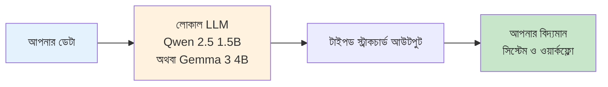

# AI Work Flow for Business

> **এন্টারপ্রাইজ অটোমেশন, ক্লাউড ছাড়াই।**
> লোকাল LLM, আসল ওয়ার্কফ্লো, কোনো ডেটা আপনার নেটওয়ার্কের বাইরে যায় না।

AI Work Flow for Business হলো **লোকাল ল্যাঙ্গুয়েজ মডেল** দিয়ে আসল এন্টারপ্রাইজ অপারেশন, ISP সাপোর্ট, ব্যাংক IT, কারখানার শিফট হ্যান্ডওভার — এসব অটোমেট করার প্যাটার্ন ও রেফারেন্স ইমপ্লিমেন্টেশনের একটি সমন্বিত লাইব্রেরি।

এটি তাদের জন্য যাদের AI সাহায্য প্রয়োজন, কিন্তু গ্রাহকের তথ্য, নেটওয়ার্ক লগ, বা অভ্যন্তরীণ নথি পাবলিক ক্লাউড API-তে পাঠানোর সুযোগ নেই।

---

## ক্লাউড LLM কি এড়ানো সম্ভব?

কখনো কখনো **না**। সংবেদনশীল ব্যবসায়িক তথ্য উন্মুক্ত না করে ক্লাউড LLM নিরাপদে ব্যবহার করতে একটি হাইব্রিড **"লোকাল গেটওয়ে"** আর্কিটেকচার প্রয়োজন।

একটি এন্টারপ্রাইজ তার প্রাইভেট লোকাল নেটওয়ার্কে একটি ছোট ওপেন-সোর্স AI মডেল (যেমন Llama 3 বা Qwen 2.5) ডিপ্লয় করে — সিকিউরিটি ফায়ারওয়াল হিসেবে। ব্যবহারকারী প্রশ্ন করলে:

1. লোকাল মডেল প্রাইভেট ডেটাবেসে সার্চ করে।
2. গ্রাহকের নাম, IP অ্যাড্রেস, অ্যাকাউন্ট নম্বর — সব সংবেদনশীল তথ্য সরিয়ে জেনেরিক টোকেন দিয়ে প্রতিস্থাপন করে।
3. শুধু অ্যানোনিমাইজড লজিক প্রবলেমটি এন্টারপ্রাইজ-গ্রেড ক্লাউড API-তে পাঠানো হয় — যা জিরো-ডেটা-রিটেনশন নীতিতে পরিচালিত।
4. ক্লাউড LLM স্ট্রাকচার্ড উত্তর ফেরত পাঠায় লোকাল নেটওয়ার্কে।
5. লোকাল গেটওয়ে আবার আসল ডেটা বসিয়ে ব্যবহারকারীকে চূড়ান্ত উত্তর প্রদান করে।

ক্লাউড LLM কখনো র, সংবেদনশীল তথ্য দেখতে পায় না।

---

## এখান থেকে শুরু করুন

-   :material-rocket-launch:{ .lg .middle } **[কেন AI Work Flow for Business?](why-ai-work-flow.md)**

    ---

    এই প্রজেক্ট কী, কাদের জন্য, এবং লোকাল-ফার্স্ট ডিজাইন কেন অপরিহার্য।

-   :material-play-circle:{ .lg .middle } **[চলতে দেখুন](demo.md)**

    ---

    ১.৫B-প্যারামিটার লোকাল মডেল দিয়ে আজকেই যা অটোমেট করতে পারেন — বাস্তব উদাহরণ।

-   :material-map:{ .lg .middle } **[অ্যাডপশন যাত্রা](adoption/index.md)**

    ---

    ডিসকাভারি থেকে শুরু করে পাইলট, বিল্ড ও এন্টারপ্রাইজ স্কেলিং পর্যন্ত চার-ধাপের গাইডলাইন।

-   :material-sitemap:{ .lg .middle } **[আর্কিটেকচার](architecture/index.md)**

    ---

    লেয়ারগুলো কীভাবে কাজ করে: LM Studio, FastAPI, ChromaDB, এবং ওয়ার্কফ্লো ইঞ্জিন।

---

## কাদের জন্য এটি

| ক্ষেত্র | যা পাবেন |
| --- | --- |
| **ISP / টেলকো অপারেশন** (NOC, ফিল্ড অপস, সাপোর্ট) | টেলিমেট্রি-ফার্স্ট কমপ্লেইন ক্লাসিফিকেশন, প্রায়োরিটি ম্যাট্রিক্স, আউটেজ কোরিলেশন |
| **ব্যাংক IT টিম** | ইন্টারনাল হেল্পডেস্ক ট্রায়াজ, হাইব্রিড BM25+ভেক্টর RAG, ফোর-আইজ অনুমোদন |
| **কারখানার অপারেশন** | শিফট হ্যান্ডওভার সামারি, সাবস্ট্রিং কন্টেনমেন্ট, সেফটি ইনসিডেন্ট অটো-এসকেলেশন |
| **এন্টারপ্রাইজ IT** | অন-প্রিমিসেস প্রাইভেট ওয়ার্কফ্লো, ডেড-লেটার কিউ, অডিট ট্রেইল |

যদি আপনি সংবেদনশীল অপারেশনাল ডেটা নিয়ে কাজ করেন, এই বই আপনার জন্য।

---

## কীভাবে কাজ করে

কোনো ডেটা আপনার নেটওয়ার্কের বাইরে যায় না। কোনো থার্ড-পার্টি API কী নেই। কোনো ভেন্ডর লক-ইন নেই। আপনার ল্যাপটপে যে কোড চলে, ডেটাসেন্টারের সার্ভারেও হুবহু সেটাই চলে।

---

## প্রজেক্ট পরিকল্পনা

লক করা সিদ্ধান্ত, ব্যবহারের ক্ষেত্র এবং রোডম্যাপের বিস্তারিত তথ্যের জন্য [ROADMAP.md](../ROADMAP.md) দেখুন।

---

## দ্রুত শুরু

1. [LM Studio](https://lmstudio.ai/) ইনস্টল করে **Qwen 2.5 1.5B Instruct** (অথবা **Gemma 3 4B**) লোড করুন।
2. লোকাল সার্ভার `http://localhost:1234/v1`-এ চালু করুন।
3. [Getting Started](../getting-started/index.md) গাইড ওপেন করে আপনার প্রথম স্ক্রিপ্ট চালান।

ব্যস। কোনো ক্লাউড অ্যাকাউন্ট নেই, কোনো API ফি নেই, কোনো টেলিমেট্রি নেই।

!!! note "আমাদের এই টুলকিট আপনারা বাংলায় পড়তে পারেন"

    আমাদের এই টুলকিটের বিস্তারিত রূপরেখা [PROJECT_SUMMARY_bangla.md](../PROJECT_SUMMARY_bangla.md) ফাইলে এক্সিকিউটিভ সামারি, টেক স্ট্যাক এবং ডিপ্লয়মেন্ট চেকলিস্ট আকারে পাবেন।

!!! question "যোগাযোগ করতে চান?"

    আমাকে WhatsApp-এ বার্তা পাঠাতে পারেন: [+8801713095767](https://wa.me/+8801713095767)। আমার সব চিন্তাভাবনা ও লেখালেখি [Medium](https://medium.com/@raqueeb), [Facebook](https://www.facebook.com/raqueeb) এবং [LinkedIn](https://www.linkedin.com/in/raqueeb/)-এ পাবেন। এর পাশাপাশি [YouTube](https://www.youtube.com/@raqueeb)-এ ভিডিও দেখতে পারেন।
