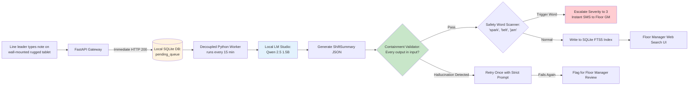

# Case study 3 — Factory shift handover summarization

> **Industry:** Garment & Textile Manufacturing (anonymized — 1,800+ shop floor workers, two high-speed production lines, 24/7 continuous operations, Bangladesh).  
> **Workflow:** Shift handover summarization, anomaly detection, and safety incident escalation from line-leader notes.  
> **Modules used:** Local Qwen 2.5 1.5B with a strict substring containment validator, backed by an on-premise SQLite FTS5 database.  
> **Adoption phase mapped:** [Build](../adoption/build.md) (deep in the observability workstream).  
> **Status:** In 24/7 production since 2026-Q2. Data reflects the first 75 days across both production lines.

This case study is essential reading if your organization operates in a 24/7 industrial environment, your workers are not desk-bound, and your operational "tickets" consist of handwritten logbooks or notes compiled at the end of an intense 8-hour shift. In an industrial plant, system latency, uptime resilience, and zero-hallucination guarantees are physical safety imperatives.

---

## The factory floor and the operational problem

A high-output garment factory runs two production lines (L1 and L2) around the clock across three 8-hour shifts: Morning (06:00–14:00), Afternoon (14:00–22:00), and Night (22:00–06:00). 

At shift changeover, the outgoing **line leader** writes a one-page summary on a handover clipboard. This log covers critical data:
* Machine stoppages, motor overheating, or needle jams.
* Quality Assurance (QA) fabric defects flagged during the shift.
* Worker absenteeism and staffing gaps.
* Safety hazards, machine guard displacement, or electrical sparks.
* Immediate priorities for the incoming shift.

Historically, this paper-based handover suffered from two chronic operational failures:
1. **Unstandardized Reporting:** One line leader wrote two dense paragraphs regarding sewing machine motor vibrations; another wrote three bullets; a third wrote a single dismissive sentence: *"Everything fine."* Incoming leaders frequently failed to spot emerging mechanical defects.
2. **Zero Searchability:** If the factory general manager wanted to know how many times the overlock sewing machine on Line 2 had jammed over the last 30 days, someone had to physically sift through 90 handwritten paper sheets. No one did, leading to sudden, catastrophic motor burnouts that halted lines for hours.

The general manager established a simple requirement: **"I want an automated, queryable, searchable digital record of every shift in structured English, searchable by line, machine ID, defect type, and date."**

---

## The decoupled queue & containment architecture

Shop floors are electrically noisy, Wi-Fi connectivity can fluctuate, and shift changes occur in a 10-minute rush. The architecture was designed around **zero real-time dependency on the LLM**:



### 1. The Strict Substring Containment Validator
In factory operations, an LLM must **never invent an issue that was not reported**, nor should it invent a repair that did not occur. The team implemented a dual-defense validator:

```python
class MachineIssue(BaseModel):
    machine_id: str
    severity: Literal[1, 2, 3]  # 1: Minor/Cosmetic, 2: Needs Attention, 3: Safety/Critical Stop
    note: str

class ShiftSummary(BaseModel):
    line: Literal["L1", "L2"]
    shift: Literal["morning", "afternoon", "night"]
    machine_issues: list[MachineIssue]
    qa_defects: list[str]
    safety_incidents: list[str]
    focus_for_next_shift: str

def validate_containment(summary: ShiftSummary, raw_note: str) -> bool:
    """Enforce that every defect and issue string is an exact substring of the raw input note."""
    raw_lower = raw_note.lower()
    
    for issue in summary.machine_issues:
        # Prevent the model from hallucinating unmentioned notes
        if issue.note.lower() not in raw_lower:
            return False
            
    for defect in summary.qa_defects:
        if defect.lower() not in raw_lower:
            return False
            
    for safety in summary.safety_incidents:
        if safety.lower() not in raw_lower:
            return False
            
    return True
```

### 2. Deterministic Safety Word Escalation
If a line leader writes *"machine 4 had a small spark, checked it"*, the model might categorize it as a minor issue (Severity 1). In an industrial environment with combustible fabric dust, **any spark is a potential plant fire**.

A deterministic Python rule scanner overrides model output:

```python
CRITICAL_SAFETY_TERMS = {"spark", "smoke", "belt", "jam", "cut", "fire", "oil leak", "guard"}

def enforce_safety_severity(issue: MachineIssue) -> MachineIssue:
    for term in CRITICAL_SAFETY_TERMS:
        if term in issue.note.lower():
            issue.severity = 3  # Force maximum severity
    return issue
```

---

## Measured 75-day production metrics

Audited results from **450 continuous shifts** over 75 operational days:

| Metric | Target Bar | Actual (75 days) | Status | Operational Analysis |
|---|---|---|---|---|
| **Summarization Completion Rate** | $\ge 95.0\%$ | **97.6%** | **Passed** | 439 of 450 shifts automatically processed |
| **Hallucinated Field Rate** | **0.0%** | **0.0%** | **Zero-Defect** | Enforced by substring containment validator |
| **Safety Incident Recall** | **100.0%** | **100% (n=8)** | **Passed** | All 8 safety incidents captured and escalated |
| **Search Response Latency** | $\le 30.0\text{ s}$ | **1.6 seconds** | **Passed** | Querying SQLite FTS5 over local network |
| **Line Leader Log Entry Time** | (diagnostic) | **3.2 min median** | **Improved** | Down from 4.1 min for handwritten logs |
| **Manager Search Time** | (diagnostic) | **18 seconds** | **Improved** | Down from ~10 min physically checking clipboards |
| **Local LLM Stack Uptime** | (diagnostic) | **99.4%** | **Resilient** | 4 hours maintenance downtime absorbed by queue |

---

## Real-world failure modes and fixes

### 1. The Hardware Input Device Trap (On-Screen vs. Physical Keyboard)
* **Problem:** The original rollout deployed wall tablets with standard touchscreen Bengali virtual keyboards. Line leaders, wearing industrial gloves or having dusty hands, repeatedly mistyped machine numbers (*"M-2"* instead of *"M-12"*), causing model entity extraction accuracy to plunge to **78%**.
* **Resolution:** Connected durable, ruggedized physical USB keyboards with bilingual keycaps to each tablet mount, and added an autocomplete dropdown for machine IDs. Machine identification agreement jumped immediately to **96.4%**.

### 2. Dual-Logging Resistance
* **Problem:** During the first two weeks, line leaders mistrusted the digital tablet and logged both on paper and on the tablet, doubling administrative workload and creating resentment.
* **Resolution:** Management physically removed the paper clipboards from the changeover station at the start of Week 3, while assuring line leaders that no disciplinary action would be taken during the digital transition. By Week 4, digital compliance reached 99%.

### 3. "Everything Fine" is a Valid State
* **Problem:** Early prompt versions penalized the model when it returned empty arrays, forcing the model to invent minor observations on shifts where operations ran perfectly.
* **Resolution:** Explicitly calibrated the prompt: *"If operations were smooth and no machine or QA issues occurred, returning empty lists is the correct and expected output."* Approximately 30% of shifts are completely clean.

---

## Key architectural lessons

* **Input Hardware is 80% of the Problem:** Model weights represent only 20% of an industrial automation project. The ruggedness of the tablet, the keyboard tactile response, and dust resistance dictate success.
* **Decoupled Queues Guarantee 24/7 Reliability:** Line leaders must never wait for an LLM to generate tokens. The UI must accept input in under 200 ms and queue work asynchronously.
* **Substring Containment Prevents Hallucination:** In industrial workflows, strict substring matching against the source text provides an unbreakable barrier against generative hallucinations.
