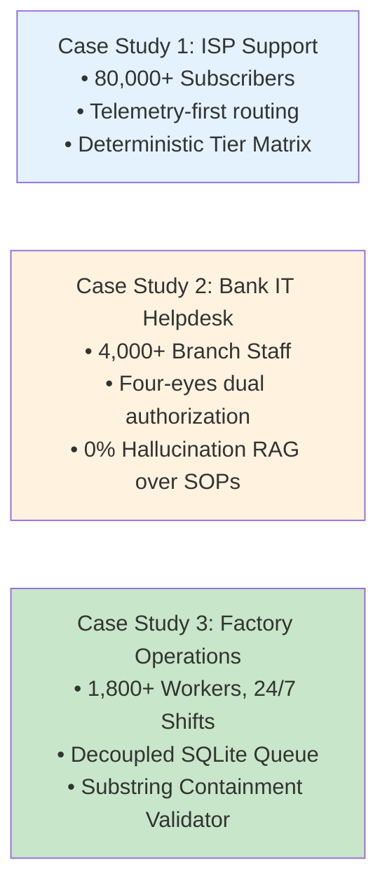

# Production Case Studies

Real-world architectural walkthroughs and audited production metrics for AI Work Flow for Business deployed across three core enterprise operational verticals.

Every case study in this section documents live operational deployments: the baseline problem, the architectural design, the audited production numbers, the real failure modes, and the concrete lessons learned.

---

## The three production studies at a glance

| Vertical | Operational Environment | Primary Architectural Pattern | Core Defensive Mechanism | Chapter Link |
|---|---|---|---|---|
| **ISP / Telecom** | 24/7 Network Operations Center (NOC), high ticket velocity | **Two-Phase Pipeline:** Deterministic SNMP/TR-069 checks before LLM invocation | Deterministic Tier $\times$ Category SLA lookup matrix in code | [Read ISP Study](isp-support.md) |
| **Commercial Bank** | Regulated internal helpdesk & CBS procedural assistance | **On-Premise Hybrid RAG:** BM25 lexical search + ChromaDB dense vector store | Strict Citation-in-Set validation & Four-Eyes dual signoff | [Read Bank Study](bank-it.md) |
| **Garment Factory** | 24/7 continuous industrial production, non-desk shift leaders | **Decoupled Asynchronous Queue:** Local SQLite buffer with background workers | Strict Substring Containment & Safety Keyword Escalation | [Read Factory Study](factory-it.md) |

---

## Why these three operational environments?

These three verticals represent the foundational testing ground for on-premise Small Language Model (SLM) automation:

1. **ISP Support (High Velocity & Narrow Semantics):** Proves that a lightweight 1.5B model (Qwen 2.5 1.5B) can outperform manual ticket routing while maintaining sub-second latency on standard workstation GPUs.
2. **Bank IT (Maximum Security & Zero Cloud Leak):** Proves that on-premise deployment satisfies stringent central bank regulatory standards, cryptographic audit logging, and strict 0% hallucination guarantees.
3. **Factory Operations (Industrial Reliability & Physical Safety):** Proves that asynchronous queue-backed architectures keep operations running 24/7 regardless of network fluctuations, model reboots, or rugged input conditions.

---

## Reading guide

* To understand how workflows are screened before engineering begins, see [Adoption: Discover](../adoption/discover.md).
* To see the 4-layer system contract that underpins these deployments, see [Architecture Layers](../architecture/layers.md).
* For technical implementation contracts and Pydantic schemas, see [Reference: Python API](../reference/python-api.md).
