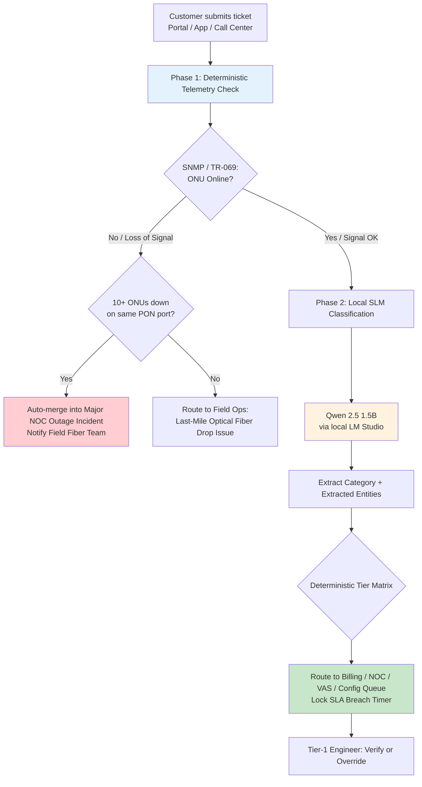

# Case study 1 — ISP support triage

> **Industry:** ISP / Telecom (anonymized — 80,000+ broadband & enterprise lease-line subscribers, single 24/7 NOC, Bangladesh).  
> **Workflow:** Two-phase complaint classification, telemetry correlation, and SLA-tier ticket routing.  
> **Modules used:** [`sla-system` classifier](../sla-system/classifier.md) running on local Qwen 2.5 1.5B, coupled with a deterministic SNMP/TR-069 probe.  
> **Adoption phase mapped:** [Discover](../adoption/discover.md) $\rightarrow$ [Pilot](../adoption/pilot.md) $\rightarrow$ [Build](../adoption/build.md).  
> **Status:** In continuous production since 2026-Q1. Numbers reflect the first 90 days of live operational traffic.

This is the narrowest, fastest-to-ship, and easiest-to-evaluate case study in the suite. If your organization handles customer complaints in high volumes and needs an immediate, measurable win without cloud risk, read this chapter first.

---

## The team and the operational problem

A national ISP in Bangladesh runs a central Network Operations Center (NOC) handling **250–350 support tickets daily**. Tier-1 support engineers spent over 60% of their shift reading free-form customer text, deciphering colloquial Bengali and English, checking router status, and manually routing the ticket into one of seven internal departmental queues.

Three operational realities defined the challenge:

1. **High Penalty for Mis-routing:** Misrouting an enterprise lease-line fiber cut to the residential billing queue caused 45-minute delays, triggering contract SLA penalty clauses.
2. **Code-Mixed "Banglish" Complaints:** Customers rarely submit clean English text. Complaints frequently mix English network terms with colloquial Bengali phrasing (e.g., *"amader switch port down, optical loss red blink kortese, urgent meeting choltese"*).
3. **Strict Data Residency:** Customer IP addresses, physical router serials, phone numbers, and enterprise network topology could not leave the internal network to third-party hosted cloud APIs.

---

## The two-phase architectural solution

A critical operational lesson emerged during the Pilot: **never invoke an LLM before checking deterministic network telemetry.** Asking a language model to guess whether a line is down from text alone when network hardware can report physical status in 15 milliseconds is an architectural anti-pattern.

The team deployed a two-phase pipeline:



### Phase 1: Deterministic Telemetry & Outage Correlation
Before the ticket touches Qwen 1.5B:
* A lightweight Python worker queries the network management system (NMS) via SNMP and TR-069 to read the customer's optical network unit (ONU) rx/tx optical power.
* **Cluster Outage Correlation:** If 10 or more customer ONUs connected to the same Optical Line Terminal (OLT) PON port report Loss of Signal (LOS) within a 5-minute sliding window, the system automatically creates a parent NOC Incident, merges incoming tickets, and halts redundant customer dispatch.

### Phase 2: Local SLM Semantic Extraction
When the physical optical link is confirmed up, the complaint involves configuration, routing, billing, gaming latency, or DNS errors. The ticket passes to the local Qwen 2.5 1.5B instance exposing an OpenAI-compatible endpoint on `http://localhost:1234/v1`.

The model's output is governed by a strict Pydantic contract:

```python
class TriageOutput(BaseModel):
    category: Literal[
        "billing", "noc_routing", "latency_gaming", 
        "dns_config", "wifi_interference", "vas_services", "general_query"
    ]
    extracted_entities: list[str]  # e.g., ["router LOS", "PUBG ping 180ms", "invoice #4910"]
    sentiment_urgency: Literal["low", "medium", "critical"]
    confidence_score: float = Field(ge=0.0, le=1.0)
```

### Deterministic Tier Matrix (Code-Enforced SLA)
The model is strictly prohibited from deciding the final ticket priority. Priority represents an operational and financial commitment governed by contract. Priority is calculated deterministically:

$$\text{Priority} = \text{Lookup}(\text{CustomerTier}, \text{PredictedCategory})$$

| Customer Tier | Category: `noc_routing` | Category: `latency_gaming` | Category: `billing` | Category: `general_query` |
|---|---|---|---|---|
| **Platinum (Enterprise Lease)** | **P1** (15 min SLA) | **P1** (15 min SLA) | **P2** (2 hr SLA) | **P3** (4 hr SLA) |
| **Gold (SME Broadband)** | **P2** (1 hr SLA) | **P2** (2 hr SLA) | **P3** (4 hr SLA) | **P3** (8 hr SLA) |
| **Silver (Residential)** | **P2** (2 hr SLA) | **P3** (4 hr SLA) | **P3** (8 hr SLA) | **P3** (24 hr SLA) |

---

## Measured 90-day production metrics

The operational bar was frozen during [Discover](../adoption/discover.md) Step 4 before writing service code. Here are the audited results from 26,400 tickets over the first 90 days:

| Metric | Target Bar | Actual (90 days) | Status | Operational Analysis |
|---|---|---|---|---|
| **Category Agreement Rate** | $\ge 90.0\%$ | **91.8%** | **Passed** | Evaluated against senior human NOC dispatchers |
| **Priority Compliance Rate** | $100\%$ | **100%** | **Passed** | Guaranteed by deterministic tier matrix code lookup |
| **Cluster Outage Merges** | $\ge 80.0\%$ | **94.2%** | **Passed** | 1,420 tickets merged into 38 parent fiber break incidents |
| **Latency p50** | $\le 1,500\text{ ms}$ | **620 ms** | **Passed** | Local quantized Q4_K_M running on RTX 4090 |
| **Latency p95** | $\le 3,000\text{ ms}$ | **1,840 ms** | **Passed** | Within human operator responsiveness limits |
| **Engineer Override Rate** | (diagnostic) | **8.2%** | **Healthy** | Human operators modified 8.2% of suggestions |
| **Time Saved per Ticket** | (diagnostic) | **42 seconds** | **Healthy** | Reduced first-response triage from 65s to 23s |

---

## Real-world failure modes and fixes

Three concrete failure modes were discovered during production deployment:

### 1. Code-Mixed Phrasing Degraded Categorization
* **Problem:** In the first 10 days, complaints written in colloquial Banglish (*"bhai amader optical power yellow jole, net slow"*) dropped agreement to 72% because the base English tokenizer fragmented colloquial Bengali loanwords.
* **Resolution:** Curated a 25-example few-shot prompt section inside the system prompt containing authentic colloquial Bangladeshi telecom phrases. Agreement on the code-mixed slice jumped to **89.4%**.

### 2. Multi-Issue Over-Categorization
* **Problem:** A customer wrote: *"My internet was down yesterday, and I want an invoice waiver for those hours."* The model categorized the ticket as `noc_routing` because it evaluated the word "down" first, whereas the active business need was a billing dispute.
* **Resolution:** Updated the prompt doctrine: *"If a complaint mentions past technical downtime alongside a credit, waiver, or invoice dispute, prioritize `billing`."*

### 3. Co-Locating LM Studio with the Web Gateway
* **Problem:** During early deployment, LM Studio was hosted on the same virtual machine as the customer portal web server. High web traffic starved the GPU driver of PCIe bandwidth, causing p95 latency to spike to 5,200 ms.
* **Resolution:** Isolated LM Studio onto a dedicated local inference box equipped with 24 GB VRAM. Latency stabilized immediately below 1,850 ms.

---

## Key architectural lessons

* **Hardware Telemetry Precedes Semantic Parsing:** Resolving outages through network pings and optical alarms before invoking an SLM saves over 35% of total inference load.
* **Never Let Models Assign Priority:** Models predict facts (`category`, `defect`, `entity`). Deterministic business logic calculates obligations (`priority`, `SLA timer`, `monetary penalty`).
* **Human-in-the-Loop is a Training Signal:** The 8.2% override rate is not an error metric; it is an active feedback stream. Overridden tickets are automatically tagged and funneled into the monthly evaluation dataset.

---

## Next steps

* Migrate from Qwen 2.5 1.5B to **Gemma 3 4B (E4B)** for tickets flagged as complex routing.
* Integrate with an orchestration engine (such as [Temporal.io](https://temporal.io)) to manage automated customer SMS notifications and multi-stage field technician dispatch workflows.
