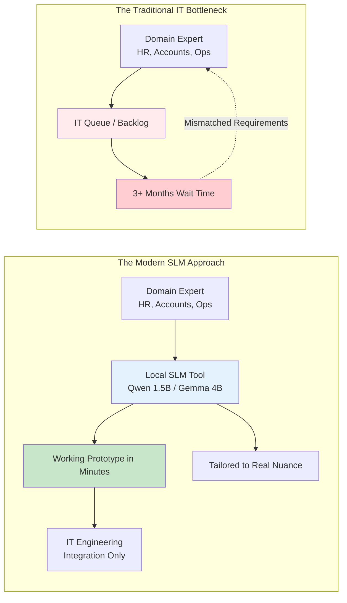
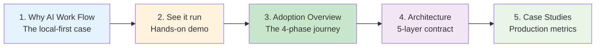

# Project Overview

AI Work Flow for Business is a working library of architecture patterns, operational playbooks, and reference implementations for deploying small, local language models (SLMs) directly into enterprise operational workflows. 

Every pattern on this site is engineered to solve everyday enterprise friction — customer complaint triage, employee leave policy inquiries, SLA breach prediction, factory shift handover summarization, and internal IT helpdesk routing — with **zero data crossing your network boundary**.

---

## Why this project exists: the non-technical empowerment shift

For decades, enterprise automation was locked behind a structural bottleneck:

### The core insight: domain wisdom is the rarest asset

When software engineers discuss AI, the conversation frequently gravitates toward infrastructure: GPU clusters, model quantization, tokenizer algorithms, and distributed vector stores. 

While technical infrastructure matters, the **rarest asset in any enterprise is domain knowledge**:
* An **Accounts Manager** knows precisely where vendor invoices stall during 3-way matching.
* A **Logistics Officer** understands which transit corridors experience customs delays during monsoon season.
* An **ISP NOC Supervisor** recognizes the exact signature of a fiber cut versus localized gateway congestion.
* A **Factory Floor Leader** knows which overlock machine jams when line speed exceeds standard thresholds.

Historically, transforming this domain wisdom into software required convincing IT to prioritize a project, waiting in a multi-month queue, and receiving a rigid system that failed to capture operational subtleties.

**Local Small Language Models (SLMs) break this cycle.** A non-programmer manager equipped with a 1.5B-parameter model running on a local workstation can validate a triage logic, curate an operational evaluation set, and test an automated workflow within hours. IT is no longer required to build every custom feature; IT provides the hardened gateway and integration rails.

---

## Who this book is for

This site addresses two distinct operational audiences:

| Operational Audience | Primary Focus | What you get from this book |
|---|---|---|
| **Corporate Decision Makers** *(Operations Directors, NOC Leads, HR & Finance Heads)* | Determining viability, screening candidate workflows, estimating ROI, ensuring compliance. | • 1-Day Discover pre-mortem methodology. • Data residency compliance frameworks. • Phased adoption roadmap (Discover $\rightarrow$ Scale). • Executive decision memo templates. |
| **Engineers & Technical Analysts** *(Platform Engineers, FDEs, SysAdmins, Developers)* | Implementing local inference, Pydantic schemas, containment validators, and production services. | • FastAPI and LM Studio client architectures. • ChromaDB vector RAG retrieval pipelines. • Multi-attacker threat models and audit logs. • Hardened Python reference implementations. |

---

## What you will find across the documentation

The documentation is organized into five progressive sections:

1. **Get Started:** The 5-minute local run, connecting to LM Studio, and running your first structured classification script.
2. **Adoption Journey:** The 4-phase playbook (**Discover $\rightarrow$ Pilot $\rightarrow$ Build $\rightarrow$ Scale**) and the role of the Forward Deployed Engineer (FDE).
3. **Architecture:** The 5-layer separation of concerns, data-flow boundaries, audit log specifications, and the on-prem security threat model.
4. **Case Studies:** Three battle-tested production studies with measured 75-day metrics across **ISP Support Triage**, **Bank IT Helpdesk**, and **Factory Shift Handover**.
5. **Reference:** Complete contracts for public CLI commands, Pydantic schemas, versioned prompt templates, and the enterprise glossary.

---

## Recommended reading path

If you are visiting this documentation for the first time, follow this sequence:

* For the technical deep-dive into on-prem contracts, explore [Architecture Layers](architecture/layers.md), [Data Flow](architecture/data-flow.md), and [Security](architecture/security.md).
* For the Bangla mirror of this overview and project philosophy, see [বাংলা - সহজ আলাপ](bangla/overview.md).
